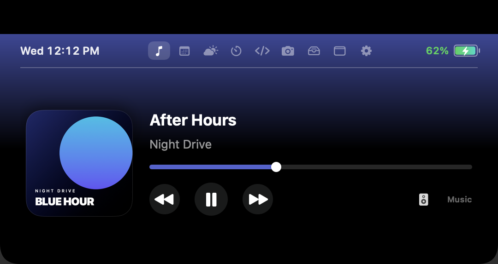
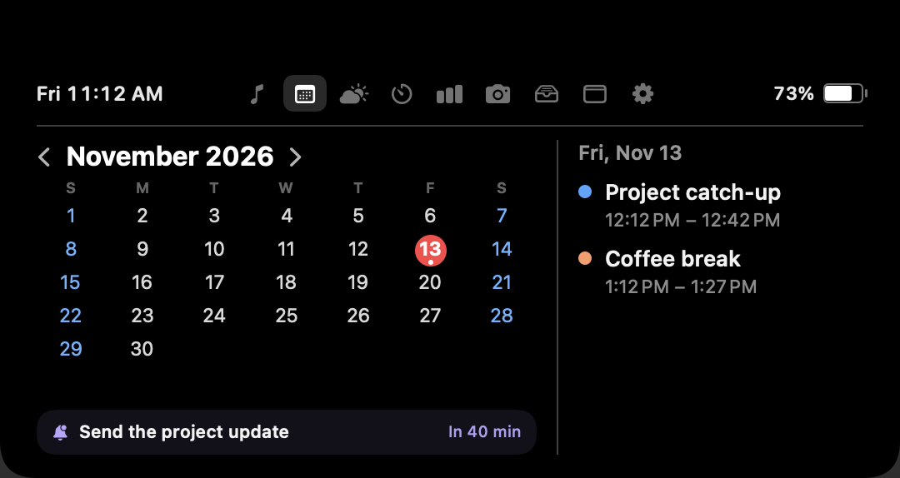
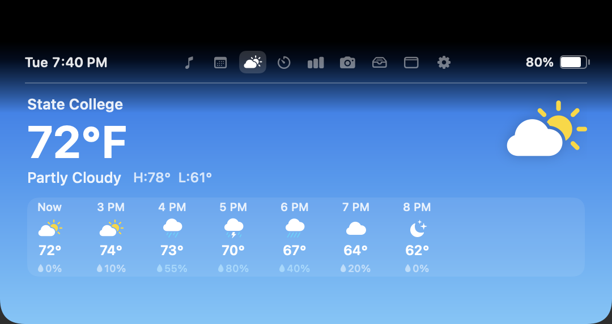
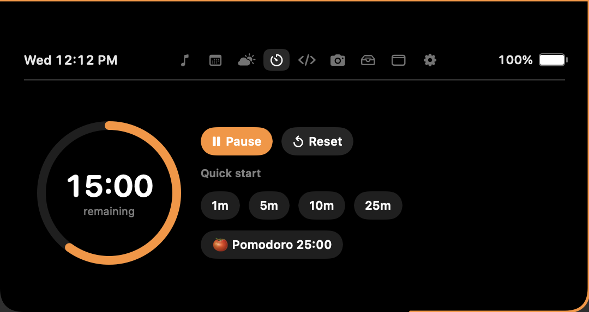
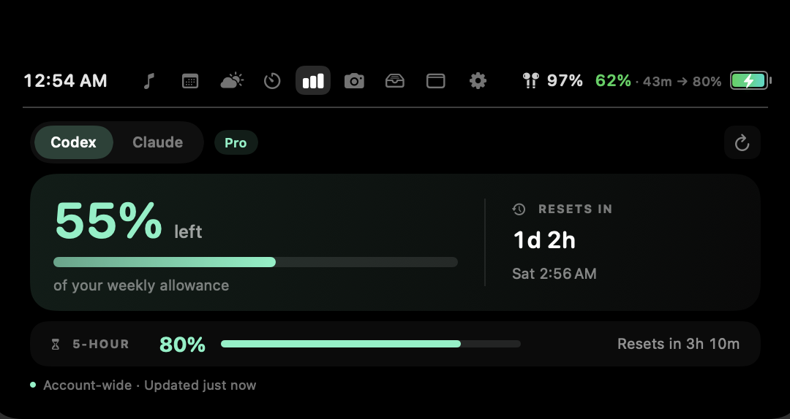
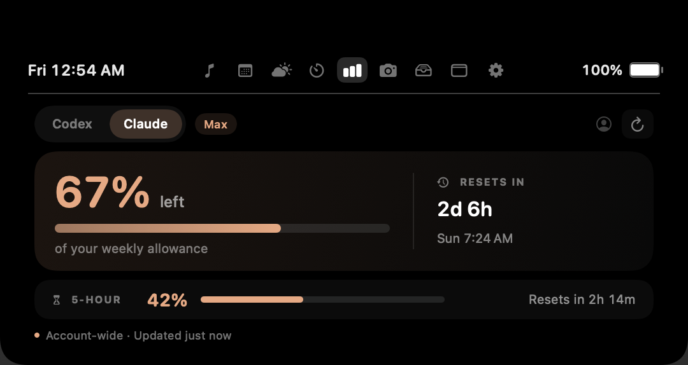
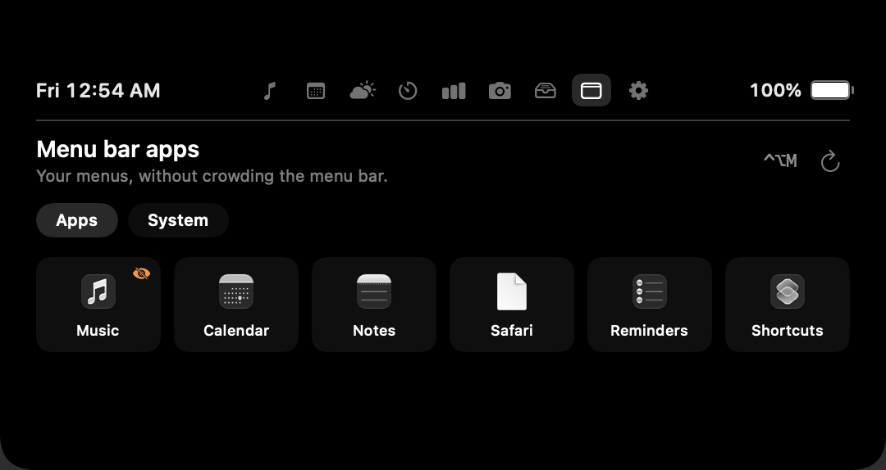
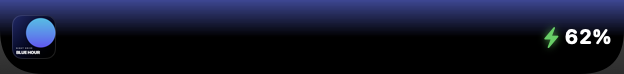
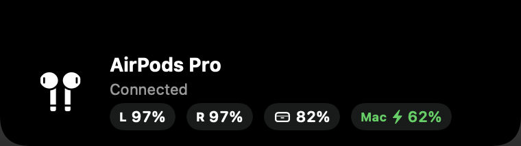
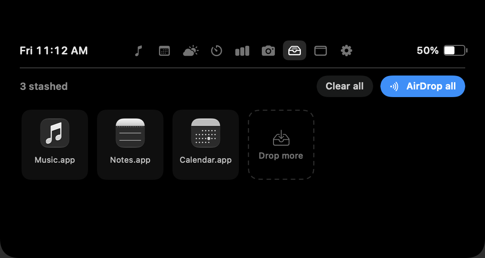

# NotchNest

A macOS notch app, built on an M3 MacBook Pro. Hover over the notch to open music
controls, your calendar, reminders and a few other tools. Move away to close it.
Every tab uses the same panel size.



## What it does

Music is the main attraction. NotchNest reads Apple Music artwork and uses its
colors for the background. Pause for 30 seconds and the background returns to
black, the compact artwork disappears and the Music tab shows "Nothing playing."
Resume and the overview comes back, with artwork, playback controls, a seek bar
and an audio output menu. Spotify playback is supported too.

Calendar puts a month grid beside the selected day's events. Each visit starts
on today. A small reminder card below the events shows your next dated task.
If nothing is upcoming, it shows the most recently overdue reminder. Click the
card to open Apple Reminders. NotchNest never completes or edits reminders.

The other tabs cover a few everyday jobs.

- Weather shows State College conditions, an hourly forecast and rain chances.
- Timer has 1, 5, 10 and 25-minute presets, with a countdown around the notch.
- The AI Usage tab switches between Codex and Claude weekly allowance, reset time
  and subscription tier, plus the rolling 5-hour limit and when it resets. Codex uses its existing sign-in. Claude needs a separate
  one-time connection through the Connect Claude button.
- Shelf holds files you drag in and lets you send them through AirDrop.
- Mirror opens a front-camera preview and stops the camera when you leave.

The collapsed notch can show a meeting countdown, music, charging status or an
active download indicator. Small popups handle AirPods connections and battery
warnings. Focus changes and Caps Lock get brief popups too. Volume and brightness
keys use notch controls in place of the macOS HUD.

The collapsed widget keeps both black sides visible, even when they have no
indicator. Hover either side to open it.

Focus popups use Apple's shared Focus status and need the Share Focus Status
permission, plus a build signed with the Communication Notifications capability
and a matching Apple provisioning profile. Enable Share Focus Status for the modes you want to show. The popup
says "Focus" because Apple reports whether notifications are silenced, not the
name of the active mode. macOS may still display its own Focus banner.

Open the gear button to choose tabs, set quiet hours or enable launch at login.
You can turn off the reminder card there too.

The menu-bar button beside the gear opens a drawer of menu-bar apps. Press
Control-Option-M to open it without reaching a menu-bar icon, then click an app
to open its native menu. Escape, the shortcut again or a click outside closes it.
Items covered by the physical notch get an orange badge. Scanning happens only
when you open the drawer or press Refresh. Some apps do not expose their menu
through Accessibility and cannot be opened this way.

Expanded widgets stay attached to the physical notch, with a solid black strip
above their content. Native icons behind an open card are available in its drawer;
selecting one hides the card before opening the menu. The drawer separates app
menus from macOS controls, rather than filling the app grid with system helpers.
NotchNest's own menu-bar icon appears only when the MacBook display is unavailable.
The drawer does not move or hide other apps' icons.

## Screenshots

These are renders of the app's own views with sample data. The song, artwork,
events, reminder and usage figures are examples, not personal account data.

| Calendar and reminders | Hourly weather |
| --- | --- |
|  |  |

| Timer | Codex weekly allowance |
| --- | --- |
|  |  |



<details>
<summary>Collapsed notch, controls and Shelf</summary>

Menu-bar apps, with a sample hidden-item badge.



Music and charging in the collapsed notch.



Volume, brightness and a Bluetooth connection popup.




Focus and Caps Lock changes use the same small banner.


Files in Shelf, ready to drag out or AirDrop.



</details>

## Build and run

You need a MacBook with a built-in notch, macOS 14 or later, and a Swift 6 toolchain.

```sh
./build_app.sh
open NotchNest.app
```

The script builds a release app and uses an available Apple Development or
Developer ID signing identity. It falls back to ad hoc signing if neither is
available. A stable signing identity helps macOS keep permission grants across
rebuilds.

To include the Focus connection, supply the macOS provisioning profile for
`com.notchnest.app` with the Communication Notifications capability enabled.

```sh
NOTCHNEST_PROVISIONING_PROFILE=/absolute/path/NotchNest.provisionprofile ./build_app.sh
```

Without a profile, the script builds a working app with Focus disconnected.
Caps Lock and the other notch tools still work.

Move `NotchNest.app` to `/Applications` for daily use. Quit the running copy before
replacing it. The app has no Dock icon. Use its menu-bar item or Preferences to quit.

For tests, source layout and screenshot generation, see [Development](docs/development.md).

## Permissions

macOS may ask for these permissions when you use the corresponding feature.
You can review them in System Settings under Privacy & Security.

| Permission | What uses it |
| --- | --- |
| Automation | Read artwork and playback details, and control Music or Spotify. |
| Calendars | Read events after you connect Calendar. |
| Reminders | Read dated tasks after you click Connect Reminders. This is separate from Calendar access. |
| Accessibility | Handle volume and brightness keys, observe Caps Lock changes, and read and open menu-bar items. |
| Focus status | Show when Focus silences or resumes notifications. |
| Camera | Show the Mirror tab. |
| Bluetooth | Detect device connections and disconnections. |
| Downloads folder | Detect unfinished downloads and show a completion notice. |

macOS labels Reminders permission as full access. NotchNest uses it only to read
the title, due date and list details for the card. Reminder fetching stops when
the card is hidden. Codex also stops refreshing when its tab is closed and uses
your existing sign-in. It does not start model tasks or redeem reset credits.
Claude has its own app-local WebKit sign-in. NotchNest does not import cookies or
credentials from Claude Desktop or your browser. It releases the hidden web page
after each reading and only refreshes while Claude is selected in the open panel.

## TVs and external displays

With an extended desktop, the widget stays on the MacBook's built-in notch, even
when a TV is the main display. Mirroring or closing the lid for TV-only use hides
the widget and returns volume and brightness keys to macOS. Reconnecting the
MacBook display restores it. Timers and stashed files stay in memory while hidden.

## Current limits

- Weather is hardcoded to State College, Pennsylvania, and comes from Open-Meteo.
  There is no location picker or Apple Weather integration.
- Reminders need a due date. Undated tasks do not appear in the card.
- The download indicator detects temporary browser files. It does not estimate
  percentage complete or time remaining.
- Bluetooth battery details depend on what macOS reports for the device.
- HDMI volume control depends on the output device. Unsupported controls fall
  back to macOS. Brightness control targets the built-in display.
- Brightness uses a private macOS interface, so an OS update can break it.
- Codex allowance needs a signed-in Codex installation. An unavailable reading
  appears as unavailable, not as zero remaining.
- Claude needs a separate sign-in. Its web usage interface is not a public,
  versioned API, so a website change can interrupt syncing.
